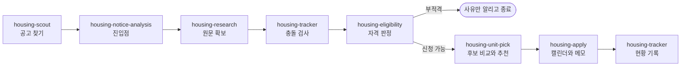

<p align="center"></p>

# ai-public-housing-analysis

A Claude Code plugin that reads Korean public-housing notices (LH, SH, HUG and more) and checks them against your own profile: eligibility, ranking, real monthly cost, commute, and which unit to apply for.

한국의 공공임대, 공공지원민간임대, 공공분양 모집공고를 **내 조건에 맞춰** 읽어 주는 Claude Code 플러그인입니다. 공고 찾기부터 자격 판정, 주택 비교, 신청 일정 등록, 신청 현황 관리까지 다룹니다.

> [!IMPORTANT]
> - 개인이 만든 비공식 프로젝트이며 LH, SH, HUG 등 어떤 기관과도 관련이 없습니다.
> - 분석 결과는 참고용입니다. 법률, 세무, 재무 자문이 아닙니다.
> - 최종 자격, 순위, 당첨 여부는 모집공고 원문과 시행 기관의 심사로 정해집니다. 신청 전에 반드시 원문과 기관 안내를 확인하세요.
> - 공고 기준은 해마다 바뀝니다. 지침은 2026년 10월에 나온 공고들로 검증했습니다.

## 왜 만들었나

공고문은 수십 쪽이고, 같은 "소득 기준"이라도 공고마다 보는 자료와 시점이 다릅니다.

- 어떤 공고는 **전년도 원천징수영수증**을, 어떤 공고는 **최신 건강보험 보수월액**을 봅니다.
- 같은 공고 안에서도 청년 특별공급과 일반공급의 소득표가 다를 수 있습니다.
- 공급호수와 예비입주자 수를 헷갈리면 당첨 가능성을 잘못 읽게 됩니다.
- 월세가 싸 보여도 늘어나는 보증금의 금융비용까지 넣으면 지금 집보다 비쌀 수 있습니다.

이 플러그인은 이런 판단을 매번 같은 순서와 기준으로 하도록 Claude에게 지침을 줍니다.

## 이렇게 물어보면 됩니다

- "이 공고 PDF 분석해 줘. 지원할 만해?"
- "이 공고에서 나는 몇 순위야?"
- "공급 목록에서 하나만 골라 줘. 가격을 더 중요하게 봐 줘."
- "요즘 넣을 만한 공고 있어?"
- "접수 첫날이랑 발표일 캘린더에 넣어 줘."
- "지금까지 어디 신청했지?"

결과가 어떤 모습인지는 [가상 인물로 만든 예시](examples/example-analysis.md)를 보세요.

## 구성

| skill | 하는 일 |
|---|---|
| `housing-notice-analysis` | 진입점. 공고 하나를 원문 확보부터 신청 일정까지 분석 |
| `housing-scout` | 접수 중이거나 곧 접수할 공고를 찾아 1차 선별 |
| `housing-research` | 공식 원문, 정정 공고, 첨부 자료 확보와 일정 대조 |
| `housing-eligibility` | 공급유형별 자격과 순위 판정, 소득 산정 자료와 시점 확인 |
| `housing-unit-pick` | 당첨 구조, 실질 비용, 면적, 출퇴근 비교와 가중치 기반 추천 |
| `housing-apply` | 캘린더 일정 2개 등록, 신청 메모, 기관 문의 문구 |
| `housing-tracker` | 신청 현황 기록, 중복신청과 재당첨 제한 충돌 검사 |



## 필요한 것

- [Claude Code](https://claude.com/claude-code)
- 공고 PDF를 읽기 위한 `pdftotext` (macOS: `brew install poppler`)
- 캘린더 등록 기능을 쓰려면 Claude Code에 구글 캘린더 연결이 필요합니다. 없어도 나머지 기능은 동작합니다.

## 설치

```bash
git clone https://github.com/jhwanchoi/ai-public-housing-analysis.git
claude plugin marketplace add ./ai-public-housing-analysis
claude plugin install ai-public-housing-analysis@ai-public-housing-analysis --scope user
```

이미 열려 있는 Claude Code 세션에서는 `/reload-plugins`를 실행하면 바로 쓸 수 있습니다.

<details>
<summary>Codex에서도 쓰려면</summary>

skill 폴더를 Codex의 skill 경로에 하나씩 링크합니다.

```bash
for s in "$PWD"/ai-public-housing-analysis/skills/*; do
  ln -sfn "$s" ~/.agents/skills/"$(basename "$s")"
done
```
</details>

## 내 프로필 만들기

개인정보는 저장소에 넣지 않습니다. 기본 위치는 `~/.config/ai-public-housing-analysis/`이고, `HOUSING_DATA_DIR` 환경변수로 바꿀 수 있습니다.

```bash
mkdir -p ~/.config/ai-public-housing-analysis
cp ai-public-housing-analysis/profile.example.md ~/.config/ai-public-housing-analysis/profile.md
```

| 파일 | 내용 |
|---|---|
| `profile.md` | 내 프로필. 비워 두면 Claude가 필요한 항목만 물어봅니다. |
| `applications.md` | 신청 현황. `housing-tracker`가 만들고 관리합니다. |
| `private-patterns.txt` | (선택) 커밋을 막을 개인 값 정규식. 한 줄에 하나 |

## 기여할 때: 커밋 전 개인정보 검사

이 저장소를 고쳐서 커밋한다면 hook을 켜 두세요.

```bash
git config core.hooksPath hooks
```

`hooks/pre-commit`이 `scripts/check-private.sh`를 실행하고 아래 경우 커밋을 막습니다.

- 프로필이나 신청 현황 파일, 공고 원문(PDF, HWPX, XLSX), 이미지가 스테이징된 경우 (플러그인 아이콘은 예외)
- 새로 추가한 줄에 이메일, 휴대전화 번호, 주민등록번호 형식이 있는 경우
- 새로 추가한 줄이 `private-patterns.txt`의 패턴과 일치하는 경우

`skills/` 지침을 바꾸는 변경은 이 플러그인을 쓰는 모든 사람의 분석 결과를 바꿉니다. PR을 보내실 때는 근거가 된 공고와 쪽수를 함께 적어 주세요.

## 라이선스

[MIT](LICENSE)
